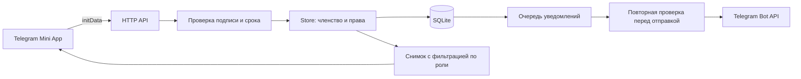

# Архитектура

Приложение состоит из браузерного интерфейса, HTTP API и Telegram-обработчика в одном процессе Node.js. Данные хранятся в локальной SQLite-базе. Python запускается отдельным процессом только для обновления каталога расписаний.

## Поток запроса

Обычный браузер запускает демо. Его состояние сохраняется в localStorage и обрабатывается теми же чистыми функциями, но не подтверждает права на сервере.

## Модули

| Файл                         | Ответственность                                                            |
| ---------------------------- | -------------------------------------------------------------------------- |
| `public/app.js`              | Состояние экрана, навигация, формы и вызовы API                            |
| `public/ui.js`               | Экранирование HTML, иконки, поля форм и скачивание                         |
| `public/model.js`            | Календарь, недели, подгруппы, ключи отметок и статистика                   |
| `public/actions.js`          | Валидация и изменения состояния группы                                     |
| `public/profile.js`          | Настоящие имена, приветствия, календарь профиля и вложения причин          |
| `public/features.js`         | Версия, настройки, время Москвы, статусы объявлений                        |
| `public/xlsx.js`             | Минимальный OOXML/ZIP writer; значения записываются как строки, не формулы |
| `server/index.mjs`           | Маршруты HTTP, лимит запросов и тела, статические файлы, запуск процесса   |
| `server/auth.mjs`            | HMAC и срок Telegram initData, нормализация подписанной личности           |
| `server/store.mjs`           | Транзакции, группы, профили, снимки по ролям и миграционные копии          |
| `server/schema.mjs`          | Схемы таблиц SQLite                                                        |
| `server/features.mjs`        | Обращения, настройки, автоотметки и планирование объявлений                |
| `server/delivery.mjs`        | Решение: отправить, отложить, подавить или признать устаревшим             |
| `server/telegram.mjs`        | Long polling, callbacks, опросы, отправка очереди                          |
| `server/misis.mjs`           | Запуск Python и применение выбранного расписания к группе                  |
| `server/catalog-storage.mjs` | Чтение каталога и атомарная замена файла                                   |
| `scripts/misis.py`           | Получение официальных XLS/XLSX и разбор поддерживаемых форматов            |
| `scripts/requests.mjs`       | Чтение сообщений об ошибках оператором сервера                             |

`featureMethods` подключаются к прототипу `Store` один раз при загрузке модуля. Они используют ту же базу и транзакции. Здесь выбран небольшой набор модулей без DI-контейнера и frontend-фреймворка. Полная декомпозиция экранов по компонентам пока не выполнена; `app.js` остаётся самым крупным модулем.

## Контракты данных

- Telegram ID хранится как строка, даже если Telegram передаёт число.
- Дата занятия — `YYYY-MM-DD`, время — `HH:MM` в Москве. Дни недели: воскресенье `0`, понедельник `1`. Недели: `odd`, `even`, `all`.
- У занятия есть повторение по дню/неделе либо конкретная `date`. `validFrom`/`validTo` сохраняют исторические версии импортированных шаблонов.
- Ключ отметки: `date|lessonId|memberId`. Значения: `present`, `late`, `absent`, `excused`, `unknown`. Нет значения — значит `unknown`, а не прогул.
- Подгруппа ограничивает применимость занятия к студенту. Исторические отметки сохраняются после выхода из группы.
- `Store.read()` возвращает внутренние данные. Для ответа клиенту используется `Store.snapshot()`, который убирает чужие отметки, участников, приватные сведения и тела файлов согласно роли.
- Файлы хранятся как base64 data URL. Получение материала, причины или вложения обращения проходит отдельную проверку доступа.
- `day_answers` фиксирует включённые автоотметки за день, `auto_marks` — происхождение конкретной отметки. Индивидуальное исправление убирает признак автоматического происхождения, поэтому отмена дня его не стирает.

## Хранение и транзакции

В `groups.data` находится JSON состояния группы: настройки, участники, занятия, отметки, материалы и объявления. Членство и роль проверяются через отдельную таблицу `members`. Профили, обращения, подтверждения объявлений, настройки и очередь имеют отдельные таблицы.

`Store.transaction()` выполняет синхронный callback внутри `BEGIN IMMEDIATE / COMMIT`; при исключении происходит `ROLLBACK`. Сетевые вызовы выполняются вне транзакций. Перед переходом со старых схем создаётся согласованная копия через `VACUUM INTO`. Создание таблиц повторяемое; отдельного framework миграций нет.

Каталог сначала читается из постоянного хранилища, затем из необязательного локального `public/misis-data.json`. При отсутствии обоих возвращается пустой каталог и доступна первая загрузка. Повреждённый JSON не скрывается под пустым каталогом. Запись идёт во временный файл с последующим переименованием.

## API

Все `/api/*` требуют заголовок `Authorization: tma <initData>`. Сохранять этот заголовок в логи нельзя. Для живых запросов действует срок подписи в один час и лимит запросов на пользователя. POST до заполнения настоящего имени блокируется, кроме `/api/profile`.

| Маршруты                                                                    | Назначение                                                                       |
| --------------------------------------------------------------------------- | -------------------------------------------------------------------------------- |
| `GET /health`                                                               | Доступность процесса, версия, наличие токена; не проверяет Telegram или доставку |
| `GET /misis-data.json`                                                      | Публичный каталог расписаний                                                     |
| `GET /api/state`                                                            | Доступные группы и снимок выбранной группы                                       |
| `POST /api/profile`, `/api/preferences`                                     | Профиль и личные настройки                                                       |
| `POST /api/groups`, `/api/join`, `/api/groups/prefer`, `/api/groups/remove` | Создание, вступление, приоритет и выход/удаление                                 |
| `POST /api/action`                                                          | Изменения группы через валидацию `applyAction`                                   |
| `POST /api/misis/refresh`, `/api/misis/import`                              | Обновление каталога и подтверждённый импорт старостой                            |
| `POST /api/day-answer`, `/api/announcements/read`                           | Автоотметки и подтверждения объявлений                                           |
| `GET/POST /api/requests`, `POST /api/requests/reply`                        | Обращения и ответ старосты                                                       |
| `GET /api/material`, `/api/excuse-file`, `/api/request-file`                | Разрешённые пользователю вложения                                                |
| `POST /api/report`                                                          | Отправка отчёта старосте в Telegram                                              |

## Проверки

Node.js-тесты проверяют авторизацию, роли, изоляцию групп, даты, импорт, Excel, настройки, очередь, миграции и обращения. Python-тесты создают небольшие XLSX-файлы в памяти и проверяют объединённые ячейки, подгруппы, недели, время, ограничения дат и неизвестные форматы.

Тесты не обращаются к живому Telegram или МИСИС. Локальные браузерные проверки выполнялись с имитацией Telegram SDK; воспроизводимый обязательный CI состоит из Node.js/Python-проверок и Docker smoke test.
